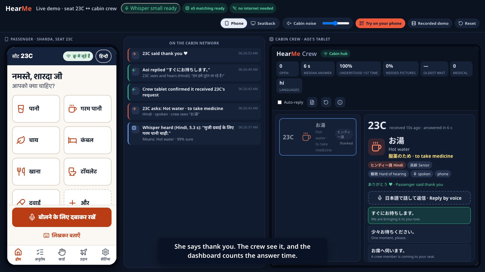
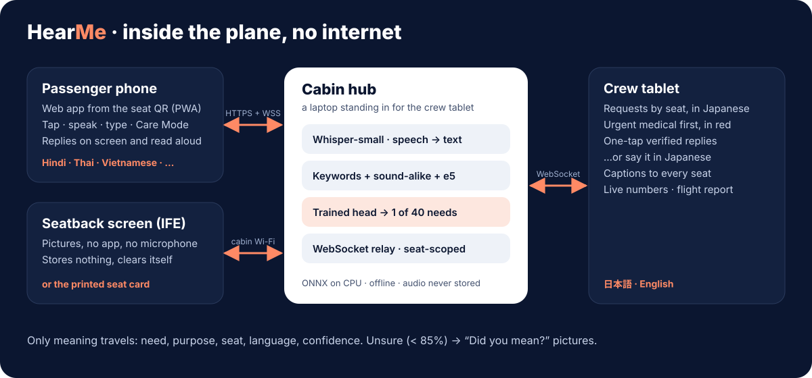
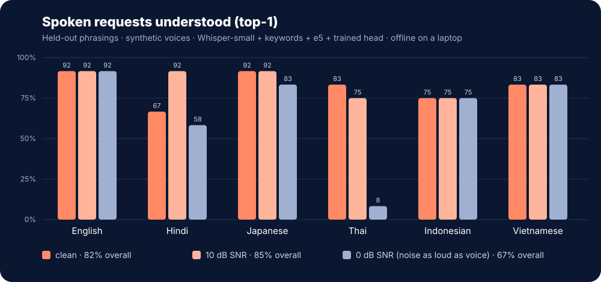
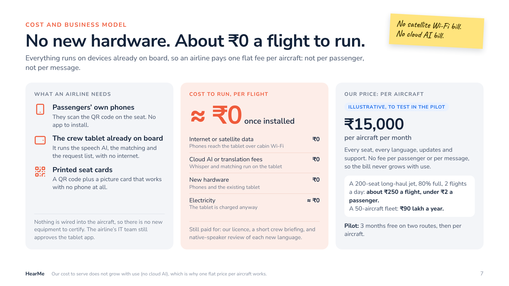

# HearMe

Use the right-side **Online / Offline mode** switch. Offline mode preserves the original local models. Online mode uses Saaras, Groq, Sarvam translation and Bulbul for ten Indian languages plus English, while other Asian languages stay local. Spoken requests submit automatically after a pause. See [modes and usage](docs/MODES.md).

> Helping passengers and cabin crew understand each other. In any language. In a noisy cabin. Even with no internet.

A working prototype of *HearMe · Idea Submission* by Nidhish Bansal, Dhruv Mittal and Dibyanshu Samal.

This repository extends the [original offline prototype](https://github.com/Dhruv-ux-dev/HearMe) with online speech processing and Online / Offline modes.

**Example.** Sharda is 68, speaks only Hindi and is a little hard of hearing. She holds her phone's microphone and says *"मुझे दवाई के लिए गरम पानी चाहिए"*. About three seconds later the crew tablet shows **23C · お湯 · 薬を飲むため** (hot water, to take medicine) in Japanese. One tap sends *"I'll bring it right away"* back to her in Hindi, on screen and read aloud. Speech recognition and matching run on a laptop standing in for the crew tablet, with no internet.

▶ **[Watch the demo](docs/demo.mp4)**, recorded from the running prototype with `npm run record-demo`. There is also a [30-second silent clip for slides](docs/demo-short.mp4). Decks: [idea submission](docs/deck/HearMe_Idea_Submission.pdf) and [with results](docs/deck/HearMe_Deck_Results.pdf) (slide 7: [cost and business](#cost-and-business)). Judges' questions are answered [below](#questions-judges-ask).



| [Care Mode: urgent report, doctor call captioned on every seat](docs/screenshots/care-mode.png) | [Crew console](docs/screenshots/crew.png) | [Launcher](docs/screenshots/launcher.png) | [Printable seat cards](docs/screenshots/seats.png) |
| --- | --- | --- | --- |

---


## Get it running

```bash
git clone https://github.com/dibyanshusamal9/HearMe.git
cd HearMe
npm install
npm run demo -- --check   # what is missing, if anything
npm run demo              # first run downloads the offline AI models (~480 MB), then opens the demo stage
```

Then open `http://localhost:8080/#/stage` and press **Run the story**. To test with a phone, see [Run the demo](#run-the-demo).

## Run the demo

You need Node 20 or newer and about 1.5 GB of free RAM. ffmpeg is optional: it is only needed for audio from native phones.

```bash
npm install
npm run demo -- --check   # checks models, build, ports, Wi-Fi address and certificate
npm run demo
```

`npm run demo` does three things:

1. On the first run, it downloads the offline AI models into `apps/hub/.models`, about 480 MB, once.
2. It builds the apps.
3. It starts the **cabin hub** and opens the **demo stage**.

| Open | What |
| --- | --- |
| `http://localhost:8080/#/stage` | Demo stage: the phone or seatback, the network timeline and the crew tablet side by side, with cabin noise and a recorded backup of the demo. |
| `http://localhost:8080/` | Launcher: every surface, the phone QR code, seat cards and the recorded demo. |
| `https://<laptop-ip>:8443/mobile/?seat=23C` | **A real phone** on the same Wi-Fi. Scan the QR code on the stage or in the terminal. |
| `http://localhost:8080/#/crew` | Crew console. |
| `http://localhost:8080/?seat=23C#/ife` | Seatback (IFE) screen. |
| `https://<laptop-ip>:8443/seats` | Printable seat-pocket cards: a QR code per seat, plus a picture card for passengers without a phone. |
| `http://<laptop-ip>:8080/trust` | Installs the hub's certificate on a phone, so there is no warning screen (optional development setup). |
| `http://localhost:8080/#/lab` | [Voice lab](#voice-lab-real-voices-logged): teammates speak into a real microphone; every take is scored and logged. |

Options:
- `--no-ai` starts without speech (taps and typing still work).
- `--rebuild` forces a fresh build.
- `--no-open` does not open a browser.

The hub loads both AI models and **warms them up** with a short practice run when it starts, then prints *Ready after N s*, so the first request is as fast as the rest. While Whisper works, the phone shows *Listening → Understanding, about 3 s → Picture* and what it heard, instead of a spinner. The demo stage shows it too.

### On the demo stage

- **Run the story** plays Sharda's request live through the real apps and the hub in about a minute: seat QR → she speaks Hindi → the crew see it in Japanese → a one-tap verified reply, read aloud in Hindi → Care Mode → the doctor call. Taps are marked on screen and each step has a caption.
  - Her sentence is a recording (`apps/hub/data/story/hi.wav`, which you can save from the voice lab; without one, a Mac with ffmpeg makes one with its Hindi system voice), sent through Whisper and matching like live speech. So the story never depends on the room's microphone. With no recording she types it, and the end card says which happened.
  - Every step waits for the real result. If one stalls, you choose *Try again*, *Skip this step*, *Show the recording instead* or *Stop*.
- **Judge, try it** hands over to the judges: the stage phone switches to their language with phrases to try, the crew can answer automatically so one person can try it alone, and a QR code puts seat 23C on their own phone.
- The **Whisper** chip switches live between *small*, which is more accurate, and *base*, which is about 4× faster.

### Phones: open in the browser, no app installation

Scan the seat QR on the IFE welcome or home screen (or a printed seat card) after connecting to cabin Wi-Fi. The full passenger web app opens immediately with that seat selected: language selection, requests, captions, replies, and accessibility controls all run in the browser. No app download, installation, or certificate setup is required. The `/join` page also offers a direct **Open HearMe in your browser** link.

With a local development certificate, QR codes use the existing HTTP listener so passengers can use pictures and typing immediately. Voice input needs trusted HTTPS. Configure a publicly trusted certificate for the cabin domain to enable browser voice without passenger setup; local certificate setup below remains an optional development tool.

### Optional development HTTPS setup

Phone browsers only allow the microphone on HTTPS pages. The hub makes its certificate the way **mkcert** does: a small root certificate that stays on the laptop, and a server certificate for the laptop's addresses. If `mkcert` is installed (`brew install mkcert && mkcert -install`), the hub uses your mkcert root instead. Developers can visit `/trust` explicitly to configure a test phone. Passenger QR codes open the web app directly.

How many taps that takes depends on the phone. Apple and Google deliberately make installing a root certificate a Settings task, so "three taps" is only possible on older Android:

| Phone | Steps on the `/trust` page |
| --- | --- |
| Android 10 and older | Download → name it *HearMe* → OK. Three taps (Android first asks for a screen lock if the phone has none). |
| Android 11 and newer | Download, then Settings → Security → Encryption & credentials → Install a certificate → CA certificate → Install anyway → choose the file. |
| iPhone and iPad | Install the profile (Allow → Settings → Profile Downloaded → Install), then turn on trust: Settings → General → About → Certificate Trust Settings → switch on *HearMe local CA*. |
| Any phone, no steps | Start the hub with a publicly trusted certificate for a domain that points at the laptop: `HEARME_TLS_CERT=cert.pem HEARME_TLS_KEY=key.pem npm run demo`. |

- The page detects the phone, checks the secure connection itself, and opens HearMe as soon as the phone trusts the hub.
- *Is this safe?* shows the root's fingerprint (also printed in the terminal) and how to remove it after the event. Only the public certificate is served; its private key never leaves the laptop.
- *Skip this* opens HearMe without the microphone: taps and typing work over plain HTTP.
- If the QR code shows the wrong address (a laptop with several network adapters), set it: `HEARME_HOST=192.168.1.20 npm run demo`. `npm run demo -- --check` shows which certificate is in use.

### Voice lab: real voices, logged

Open `http://localhost:8080/#/lab` on the hub laptop. A teammate picks:
- who speaks: a passenger, or crew replying in Japanese;
- the language, and whether it is their first language (all ten, including Bengali, Tamil, Punjabi and Marathi, which now have held-out sentences to read like the other six);
- the place: quiet, cabin noise playing, or a noisy room;
- the microphone;
- the task: read a held-out sentence that never tuned the matcher, or ask in their own words from a picture.

Then they hold the button (or Space) and speak. The hub runs exactly what a phone runs and logs what would have appeared on screen: *right first time*, *right after "Did you mean…?"*, *missed*, *wrong one shown* or *nothing heard*, with Whisper and hub times. The page shows live tables by language, place, microphone, task and person, lets you discard an unfair take (a cough, a misread), and downloads a CSV.

- Results stay on the hub laptop in `apps/hub/.lab/takes.jsonl`, which git ignores. Recordings are kept only if the speaker ticks *Keep my recordings*.
- `npm run lab-report` writes `docs/voice-lab.md`: the headline, breakdowns, every miss, and caveats.
- To record on phones (their own microphones), start the hub with `HEARME_LAB=1`.
- A good take of the story sentence can become Sharda's voice in *Run the story* (*Use as Sharda's voice*).

### Replies read aloud, with a playback check

Crew replies are read aloud on the passenger's phone in their language, with the phone's own voice for that language. The first time, the home screen offers *Can you hear the crew's replies?*: one tap plays a real verified reply, and the passenger confirms they heard it. If the phone has no voice for their language, they are told plainly that replies will come as big text and vibration. If the sound is blocked or they did not hear it, the card says how to fix it, or switches replies to text only. The reply screen says whether it was read aloud.

---

## How it works



- **Tap it, say it, or point at it.** The passenger taps one of 40 pictures, holds the microphone, or types. Without a phone, they point at the printed seat card.
- **Understanding, not translation.** Whisper transcribes the passenger's language on the hub. Four signals then pick one of 40 needs:
  1. Exact keywords in 6 languages.
  2. A **sound-alike** tier for the way Whisper misspells what it hears (डवा → दवा, *xinh* → *sinh*, นาว → หนาว).
  3. **multilingual-e5** sentence embeddings.
  4. A **classifier trained** for cabin requests.

  At 85% confidence or above, the request is ready to send. Below that, the passenger sees *"Did you mean?"* pictures and *None of these, call crew*. When a keyword and the meaning model disagree, both are shown as pictures rather than one being guessed. *None of these, call crew* sends what the passenger said along with the call; the crew tablet shows it in their language and translated offline into Japanese and English, so the crew member arrives knowing what it is about.
- **Verified replies first.** Crew replies are pre-written phrases checked in all 6 languages. A crew member can also *say* a reply in Japanese. It is matched to the closest verified phrase and confirmed before it is sent.
- **Announcements in their own words.** The captain or a crew member types or says an announcement in Japanese. The hub translates it offline into every language on the passenger list and in today's requests, with Hindi and English always included. The crew see each translation before sending. Every phone and seatback then shows its own language and reads it aloud when the passenger has voice on. Safety announcements stay the fixed, human-written captions, and those are read aloud too.
- **Own words, labelled.** When no verified reply fits, the crew member can send their own words, spoken or typed in Japanese. The hub translates them offline with NLLB-200 (`npm run models -- translate`, ~900 MB once; the first translation loads the model in ~15 s, later ones take 1–4 s). The crew member sees the translation before sending it. The crew see the translation before sending it, because nobody checked it.
- **Care Mode.** A body map, a 0–10 pain scale, and symptom and condition lists, one tap from the home screen on both phone and seatback. The crew get a Japanese and English summary, with urgent reports first in red. One tap calls for a doctor; the call is captioned on every seat in that seat's language. The crew can also print a **handover sheet** for the doctor or the ground team.
- **Crew console.** Live numbers: open requests, median answer time, understood first time, needed pictures, oldest wait, medical, languages.
  - Click a seat to see its language and the needs shared at check-in.
  - A heat view shows which rows ask most.
  - A **post-flight report** can be printed.
- **Privacy.** Audio is processed in memory on the hub and then dropped; it is never written to disk. Only the meaning travels: need, purpose, seat, language and confidence. The seatback stores nothing. (The voice lab, a test tool, keeps recordings only when the speaker opts in.)
- **Resilience.**
  - Each transcription has a time limit, and the speech model reloads itself after repeated failures.
  - If meaning-matching fails, matching falls back to keywords.
  - Phones reconnect on their own.
  - Without a hub, the apps run a simulated crew, clearly labelled.

| Part | Stack | Folder |
| --- | --- | --- |
| Cabin hub: HTTP/HTTPS, WebSocket relay, offline AI, booking lookup, QR codes | Node + TypeScript, `@huggingface/transformers` (onnxruntime-node), `ws` | `apps/hub` |
| Passenger phone app (also native Android/iOS through Expo); 0.8 MB web bundle | Expo / React Native, exported to the web as a PWA | `apps/mobile` |
| Seatback screen, crew console, demo stage, launcher | React 19 + Vite | `apps/ife` |
| Shared core: 40 needs, translations, matcher, protocol, request state machine, Care Mode, metrics | TypeScript | `packages/shared` |

---

### Several requests in one sentence, and refusals

*"मुझे ठंडा पानी नहीं चाहिए, दवाई लेने के लिए थोड़ा गरम पानी और एक कंबल चाहिए, लेकिन खाना मत भेजिए"* means "not cold water; hot water to take my medicine, and a blanket; but don't send food". HearMe reads it that way. The sentence is split at punctuation and at "and"/"but" words in every language, and each part is matched on its own.

- **Refusing verbs, in all 10 languages:** "नहीं चाहिए", "मत भेजिए", Hinglish "nahi bhejo", "don't bring", "いらない", "ไม่เอา", "jangan", "không cần" (also typed without accents), "চাই না", "வேண்டாம்", "ਨਾ ਭੇਜੋ", "नको". Every need in that part is ruled out.
- **A bare "not X":** "चाय नहीं", "no ice", "ไม่ใช่ชา". This rules out only food, drinks, a blanket or a pillow, because "no wifi" or "TV नहीं चल रहा" is a complaint.
- **"Instead of" and "without":** these split into a wanted and a refused side ("coffee without milk", "बिना बर्फ़ के पानी", "ミルクなしで").
- **Not refusals:** phrases that carry their own negation are requests: "no meat" is a vegetarian meal, and "not feeling well" is unwell. "I can't sleep without a pillow" still asks for the pillow.
- **One request stays one:** fillers ("please") are ignored. A feeling answered by another request is its reason. "Headache tablets" is medicine, not medicine plus unwell. Punjabi ਚਾਹੀਦਾ and Bengali চাই ("need") are no longer read as tea (ਚਾਹ, চা). "To take medicine" is understood in the four pack languages too.
- **Review:** the phone lists every request with a tick box, and refused items crossed out. A crossed-out item can be ticked back in case HearMe misheard the "not". The stage shows one line per sentence: *Means: Hot water (to take medicine) + Blanket · not wanted: Water, Food*.

Measured on 79 test sentences in 10 languages (`packages/shared/src/lab/requestCases.ts`), written by the team, not by native speakers:
- **Keywords alone** (`npm test`, the phone with no hub): before this change 35 of 79 were exactly right; now 79 of 79.
- **The hub's full matcher** (`npm run multi -w @hearme/hub`): 79 of 79.
- **Single requests:** of 336 single-request phrasings (tuning, held-out and pack examples), none is now split into several or read as a refusal. Before, 13 of the 192 checked with keywords were.

## Measured results

All numbers were measured on a MacBook Air (M2, 8 GB RAM). The scripts and test phrases are in `apps/hub/src/scripts`.

> **Real voices: not measured yet.** Every speech number below comes from synthetic voices. The [voice lab](#voice-lab-real-voices-logged) is there to replace them: record teammates and volunteers on real microphones, run `npm run lab-report`, and quote `docs/voice-lab.md`.

**Typed requests in 6 languages.** The held-out set is 72 phrasings that were never used for tuning or training.

| | top-1 | right picture in top 3 | wrong but sent confidently |
| --- | --- | --- | --- |
| Keywords only (original prototype) | 72% | 75% | 1% |
| Keywords + e5 | 89% | 94% | 1% |
| **Keywords + e5 + trained classifier (now)** | **94%** | **100%** | **0%** |

**Spoken requests.** These are the held-out phrasings spoken by macOS voices, run through Whisper-small, with synthetic cabin noise (engine rumble, hum and airflow) mixed in.

| Noise | top-1 | sent without asking | wrong but sent confidently | median recognition time |
| --- | --- | --- | --- | --- |
| Clean | 82% | 53% | 1% | 3.1 s |
| 10 dB SNR | 85% | 56% | 1% | 3.5 s |
| 0 dB SNR (noise as loud as the voice) | 67% | 44% | 0% | 3.4 s |



**How the speech numbers were made, honestly:**
- The first blind run on these phrasings sent 4–6% of requests confidently with the wrong need.
- We looked at those errors and made three general fixes:
  - When a keyword and the meaning model disagree, ask instead of guessing.
  - A longer phrase heard by sound overrides the keyword inside it.
  - One Thai keyword was removed because it sits inside "ขอชาร์จ" ("may I charge").
- The table shows the results after these fixes, so it is no longer fully blind.
- On the development phrasings, which were used to design the sound-alike rules, the results are 92% / 85% / 75% top-1.
- Thai is the weak spot, especially in loud noise. Thai vocabulary and two Whisper Thai spellings (ขออยาก → ขอยา, ชาติ → ชาร์จ) were then fixed using the development set only. Thai on the held-out set went from 53% to 56%, and the development set from 50% to 64%. Folding long and short Thai vowels together was also tried: no measurable change.
- Whisper-base is about 4× faster but less accurate (57–69% top-1).

**Noise: a 300 Hz filter before Whisper.** Cabin noise is mostly engine rumble and hum below a few hundred hertz, where speech carries little of its meaning. The hub now cuts it with a 4th-order high-pass at 300 Hz, the bottom of the telephone band (`HEARME_HIGHPASS`, 0 turns it off).
- **Measured:** on 36 held-out phrasings in Hindi, English and Japanese, right first time at 0 dB SNR went from 78% to 83%.
- **Unchanged:** quiet speech stayed at 83%, and wrong-but-confident stayed at 3%.
- **Caveat:** this is a small sample with synthetic voices and noise. The full 6-language run and real voices are still to do.
- **Tried earlier and dropped:** spectral noise reduction made 0 dB worse (68% to 65%).

**15 languages, including all 11 that Sarvam AI covers, and what each one really covers.** `npm run languages` writes [docs/languages.md](docs/languages.md): one row per language, one column per layer — speech, understanding requests, passenger screens, crew replies, reading aloud, and who checked the wording. A language is never just "supported".

| | Speech | Understands | Screens | Replies | Checked by |
| --- | --- | --- | --- | --- | --- |
| Hindi, English, Japanese, Thai, Indonesian, Vietnamese | measured | all 40 needs | all | all 11 | non-native |
| **Bengali, Tamil** | weak | all 40 needs | passenger path; rest in English | all 11 | non-native |
| **Punjabi, Marathi** | not measured | all 40 needs | passenger path; rest in Hindi | all 11 | non-native |
| **Gujarati, Kannada, Malayalam, Telugu** | Whisper has them; not measured | all 40 needs | 171 strings; rest in Hindi or English | all 11 | non-native |
| **Odia** | heard as Hindi, moved into Odia letters | all 40 needs | 169 strings; rest in Hindi | all 11 | non-native |

**The newest five languages are written in each language, not translated from English or Hindi.** They began as NLLB-200 machine drafts, and the drafts were wrong in ways that clash: Telugu "tissues" was body tissue, "pillow" was also "right side", and "wheelchair" was not a word. They are now written the way a speaker says things on a flight, including the English words everyone uses (టాయిలెట్, ಚಾರ್ಜರ್, വീൽചെയർ).
- Each has its own "don't want" words (వద్దు, ಬೇಡ, വേണ്ട, નથી જોઈતું, ଦରକାର ନାହିଁ), "and"/"but" words, "without" words and purpose words, so "no food, just tea" works in all of them.
- Words that start other words are guarded: Gujarati ચા (tea) is not read inside ચાલે (works), and Telugu పోయింది (lost) is not read inside అయిపోయింది (ran out).
- Whisper has no Odia: it writes Odia speech in Hindi letters, which are moved letter for letter into Odia script so Odia words can match.
- `npm run draft-languages` never overwrites a pack written by hand.

Safety texts and the Care Mode medical lists stay human-written in Hindi or English. Everything needs a native speaker's check before a pilot. With Hindi, Bengali, Tamil, Punjabi, Marathi and English, Gujarati, Kannada, Malayalam, Odia and Telugu complete the 11 languages Sarvam AI covers.

Bengali and Tamil used to be keyword-only: a passenger spoke Bengali at English screens. They now carry their own screens and replies, and Punjabi and Marathi are new. A pack language translates the 102-string passenger path (greeting, request grid, speaking, "Did you mean?", confirming, delivery status, the offline card, Care Mode), all 40 need labels and all 11 verified replies; anything else falls back to a core language the picker names before you choose it.

**Adding a language is still a data file** — one file in `packages/shared/src/i18n/packs/<code>.ts`, plus one row in `i18n/languages.ts`. No matcher, app or crew-console code changed to add Punjabi and Marathi. A keyword-only draft can still be dropped into `apps/hub/data/languages/<code>.json` to try a language on the hub in an afternoon (`npm run add-language`); it is only ever used to *understand*, never shown to a passenger.

**Measured: the matcher on sentences it was never tuned on.** Twelve requests per language, written after the vocabulary was fixed. Scored by the **keyword matcher alone** — no embedding model, no trained classifier — so it reproduces on any laptop with `npm run languages`:

| | top-1 before | top-1 now | right picture offered before | right picture offered now |
| --- | ---: | ---: | ---: | ---: |
| Bengali | 8% | 92% | 25% | 92% |
| Tamil | 8% | 92% | 25% | 100% |
| Punjabi | 8% | 83% | 25% | 92% |
| Marathi | 50% | 100% | 58% | 100% |
| The six core languages | 74% | 74% | 76% | 76% |
| **All 120 sentences** | **52%** | **81%** | **59%** | **84%** |

The six core languages are unchanged: the packs added vocabulary without disturbing what was there. Marathi starts higher because it shares its script with Hindi. One wrong-but-confident match across all 120 (English, pre-existing).

Three honest caveats, which also appear in the generated report:
- **The pack languages' numbers are optimistic.** Their vocabulary and their test sentences were written by the same author, so words overlap in a way they would not for a real passenger. The six core languages do not have this problem. A native speaker writing a fresh set is the fix, and it has not been done.
- **No native-speaker review, anywhere** — including the original six. Care Mode wording and the safety briefing are deliberately left untranslated in every pack: they are what a crew member acts on medically, so they need clinical and airline review, and until then they appear in the fallback language. A test enforces that a pack cannot supply them.
- Two sentences still fail on keywords alone (Bengali and Punjabi, both "my body isn't doing well", neither containing a catalogue word). They were left failing rather than adding those exact words, which would have tuned the vocabulary on the held-out set and made the table meaningless.

The Tamil pack began as an NLLB-200 machine draft and was corrected by hand. The draft had called a pillow "powder", a blanket "cloth", a soft drink "alcohol" and tissues "AIDS" — which is exactly why a machine draft is never shown to a passenger.

Cost of all four languages in the phone bundle: **0.216 MB → 0.237 MB gzipped**.

**Other results:**
- **Crew voice replies:** 14 of 14 spoken Japanese phrasings matched the right verified reply. Each takes about 1.7 s.
- **Noise reduction:** tested and not used. Spectral subtraction before Whisper did not help: 65% at 0 dB with it, against 68% without.
- **Accessibility:** axe-core found no WCAG 2.1 A or AA violations on the launcher, stage, crew console, seatback, phone app or seat cards.

> These numbers come from synthetic voices and synthetic noise, not from real passengers in a real cabin. They show that the pipeline works and how it degrades with noise; they are not a field result. The design prefers asking with pictures to guessing.

---

## Cost and business



- **Hardware: nothing new.** Passengers' own phones, the crew tablet already on board, and printed seat cards.
- **Running cost: about ₹0 a flight, once installed.** There is no satellite internet (phones reach the tablet over the cabin Wi-Fi), no cloud AI or translation fee (Whisper and matching run on the tablet), and no new hardware.
- **Pricing: one flat fee per aircraft.** As an illustration, ₹15,000 a month covers every seat, every language, updates and support, with no fee per passenger or message.
  - For a 200-seat long-haul jet, 80% full, flying twice a day, that is about ₹250 a flight and under ₹2 a passenger.
  - A 50-aircraft fleet is ₹90 lakh a year.
  - These prices are assumptions to test in the 3-month pilot, not quotes.
- **Still paid for:** our licence, a short crew briefing, and native-speaker review of each new language.

The slide's source is [docs/deck/business-slide.html](docs/deck/business-slide.html). It is slide 7 of the [results deck](docs/deck/HearMe_Deck_Results.pdf), and also [a PDF on its own](docs/deck/HearMe_Business_Slide.pdf).

---

## Questions judges ask

### Certification and approval

**Does it need aircraft certification?**
Not for what this prototype uses, because nothing is installed in or wired into the aircraft. Passengers use their own phones, under the airline's existing rules for personal devices. The hub is meant to run on the crew tablet the airline already carries. It does need:
- the airline's IT and security approval of the tablet app;
- approval to use the cabin Wi-Fi network for it;
- human review of every translated text.

The seatback version would need integration with, and certification through, the IFE vendor. Here it is a browser page.

**Can a crew tablet really run this?**
Not shown yet. In this prototype the hub runs on a laptop (a MacBook Air M2) standing in for the tablet. Porting it to a tablet (ONNX Runtime Mobile or whisper.cpp) is the next step, and its speed there has not been measured.

**What if there is no cabin Wi-Fi?**
Then phones cannot reach the crew tablet. The printed seat card still works (the passenger points at a picture), and so does a connected seatback screen. Using the tablet's own hotspot would need the airline's approval.

**What about safety messages?**
Safety briefings, announcements and the doctor call are fixed, human-checked texts in every language; they are never machine-translated. HearMe helps the crew understand requests; it does not change crew procedures. An urgent Care Mode report is shown first, in red, and the crew follow their medical procedures.

### Privacy

**What happens to a passenger's voice?**
The recording goes from the phone to the crew tablet over the cabin network, is turned into text in memory, and is dropped. It is never written to disk and never leaves the aircraft. Only the meaning reaches the crew: seat, need, purpose, language and confidence, plus any needs the passenger shared at check-in (for example, hard of hearing). The only exception is the voice lab, a test tool for the team: it keeps recordings on the hub laptop, and only when the speaker ticks a box.

**What is stored, and where?**
- Hub: the flight's request list, in memory only. Restarting the hub clears it.
- Phone: the passenger's own profile and requests, on their phone, until they tap *Reset* in Settings.
- Seatback: nothing. It clears itself after use.
- Nothing goes to the internet, and there are no accounts or analytics.

**What about health data?**
Care Mode reports (where it hurts, how much, symptoms) go only to the crew, and to the handover sheet if the crew print it. A real deployment needs a privacy review under the laws that apply, such as India's DPDP Act and Japan's APPI, and clinical review of the wording.

### Accuracy

**How accurate is it?**
- Typed, 72 held-out requests in 6 languages: 94% right first time, the right picture among three every time, and none wrong-but-confident.
- Spoken by synthetic voices through Whisper-small: 82% right in quiet, 85% at 10 dB SNR, and 67% when the noise is as loud as the voice.
- Real voices: not measured yet. The voice lab is how we will measure them.

**What happens when it is wrong?**
- Below 85% confidence, HearMe asks with pictures (*Did you mean…?*) instead of guessing.
- Even when it is confident, the passenger sees the picture before sending.
- Crew replies are only pre-checked texts, and a reply matched from crew speech is confirmed by the crew before it is sent.
- The number we watch is *wrong but sent confidently*: 0–1% on the held-out sets.

**What about accents and real cabin noise?**
Whisper was trained on many accents, but our speech numbers come from synthetic voices and synthetic noise. That is why the voice lab exists, and why a field test at 75–85 dB is the first item of remaining work. Thai is the weakest of the six built-in languages, and spoken Bengali and Tamil (language packs) are weaker still, at 42–50%.

**Why not use Google Translate or an AI chatbot?**
They need internet, which most flights don't have or charge for. Their translations can be wrong in ways nobody on board can check, so HearMe never sends free translation: requests are matched to a known need, and replies are pre-checked texts. Most cabin requests are the same few dozen things, so matching is more reliable, and it works fully offline.

**How long does a passenger wait?**
About 3 seconds from releasing the button to the picture: the median Whisper-small time was 3.1 s in quiet and 3.5 s in noise, on the laptop hub. Whisper-base is about 4× faster but less accurate. The models are warmed up when the hub starts, and the phone shows each stage while it waits.

### Cost

**What does an airline pay?**
No new hardware, and about ₹0 a flight to run, because there is no satellite data and no cloud AI fee. The price is one flat fee per aircraft: as an illustration, ₹15,000 a month, which is about ₹250 a flight and under ₹2 a passenger for a 200-seat jet flying twice a day. These are assumptions to test in the pilot, not quotes. See [Cost and business](#cost-and-business).

**What does it cost you to serve?**
Almost nothing per use, because the AI runs on the airline's tablet, not on our servers. Our costs are people: translation review for each new language, support and updates. That is why a flat price per aircraft works.

**What does adding a language take?**
No new code. One file: `packages/shared/src/i18n/packs/<code>.ts` with the 40 need labels, the 102-string passenger path, the 11 verified replies and the matching vocabulary — about 1,300 words — plus one row in `i18n/languages.ts` declaring what it covers. Punjabi and Marathi were added that way and nothing else changed. For a quick trial, `npm run add-language` can draft keywords offline into `apps/hub/data/languages/<code>.json`, which the hub understands but never shows to a passenger. Either way the real cost is native-speaker review, which no language has had yet.

---

## What is real and what is simulated

| Real in this prototype | Simulated or sample |
| --- | --- |
| Offline speech recognition (Whisper) and need matching (keywords, e5, trained classifier) on the hub | Booking lookup uses a sample passenger manifest (`apps/hub/data/manifest.json`), not an airline PNR system |
| Phone ↔ hub ↔ crew over WebSocket across devices, with seat-scoped delivery, receipts and reconnects | The crew tablet is a laptop browser; there is no certified aircraft hardware |
| Microphone capture in the phone browser (echo cancellation, noise suppression, 110 Hz high-pass filter, 16 kHz) | Seatback (IFE) is a browser page with no IFE platform integration |
| Seat QR → booking → language and seat filled in, no typing | Translations are prototype drafts that need native and airline review; Care Mode wording needs clinical review |
| Offline PWA (service worker), bundled fonts, no internet calls | Without a hub, the apps fall back to a simulated crew, clearly labelled |
| *Run the story* on the stage: the recording goes through the real Whisper, matching and crew tablet | In the story the passenger is scripted: her sentence is a prepared recording, and the stage taps the buttons |
| HTTPS from a local root (mkcert-style), installed once per phone | Prices on the business slide are illustrative assumptions, not quotes |

---

## Development

```bash
npm run dev            # Vite dev server for the web apps (proxies /api and /ws to a running hub)
npm run hub            # the cabin hub on its own
npm run mobile         # Expo dev server (Expo Go on Android/iOS); set the hub address in Settings
npm run typecheck      # shared, hub, ife, mobile
npm test               # shared, hub and IFE tests (CI runs these plus the builds on every push)
npm run build          # Expo web export + web apps (apps/ife/dist)
npm run eval           # typed + crew evaluation; add `-- --speech --snr 10,0` (and `--set heldout`, `--denoise`)
npm run lab-report     # voice lab takes (apps/hub/.lab) → docs/voice-lab.md
npm run record-demo    # re-record docs/demo.mp4 (needs Google Chrome, ffmpeg, macOS `say`)
npm run train -w @hearme/hub      # retrain the need classifier (minutes, on the laptop CPU)
npm run rescore -w @hearme/hub    # re-score saved Whisper transcripts after matcher changes (seconds)
npm run zeroshot -w @hearme/hub   # Bengali / Tamil / Tagalog check
npm run languages                           # what each language covers -> docs/languages.md (no models needed)
npm run add-language -w @hearme/hub -- tl   # try a keyword-only draft from data/languages/<code>.json, retrain, measure
npm run chart -w @hearme/hub      # redraw docs/results.svg
npm run a11y -w @hearme/hub       # axe-core accessibility check of every screen
```

Settings for the hub (environment variables):

| Variable | What it does |
| --- | --- |
| `HEARME_HOST` | The address phones should use, when the laptop has several network adapters. |
| `HEARME_TLS_CERT`, `HEARME_TLS_KEY`, `HEARME_TLS_CA` | Use your own certificate (for example, a publicly trusted one): nothing to install on phones. |
| `HEARME_CERT=local` | Use the built-in root even when mkcert is installed. `HEARME_CERT_DIR` moves `apps/hub/.cert`. |
| `HEARME_LAB=1` | Let phones and other devices use the voice lab (the hub laptop always can). `HEARME_LAB_DIR` moves `apps/hub/.lab`. |
| `HEARME_STORY_DIR` | Where the story's recording is (default `apps/hub/data/story`). |
| `HEARME_ASR_MODEL=base` | Start with Whisper-base instead of small. `HEARME_THREADS` sets the inference threads (default 4). |
| `HEARME_NO_AI=1` | Start without the AI models (the same as `--no-ai`). |

## Assumptions

- **Languages:** Hindi, English, Japanese, Thai, Indonesian and Vietnamese, chosen for the persona, the crew and the India / South-East Asia routes. The crew language is Japanese.
- **The hub is the crew tablet.** The PDF puts the speech AI on the crew tablet; here it is a Node service on any laptop on the cabin Wi-Fi.
- **The seatback has no microphone or keyboard.** It offers pictures, the show-to-crew card and read-aloud replies.

## Remaining work

- Real-voice numbers from the voice lab, then a field test at 75–85 dB of cabin noise, and improve Thai.
- Run the hub on a real crew tablet and measure its speed there.
- Professional, human-checked translations; airline-approved safety and announcement content; clinical review of Care Mode.
- UI in more languages. Matching already reaches unseen languages (see above); the screens, replies and captions need translating.
- Integration with the airline booking/PNR system and the ground handover. Certified crew-tablet and IFE hardware.
- Native device testing of the Expo app. In this environment it has been exercised on the web build only.

