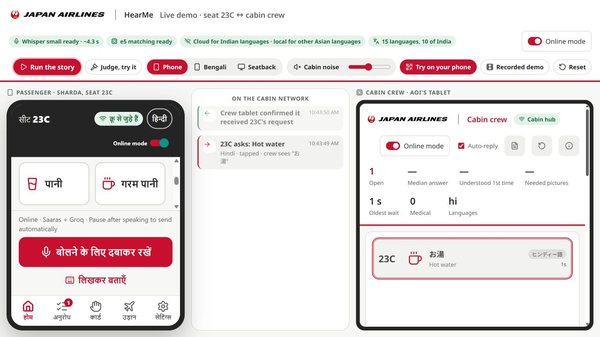
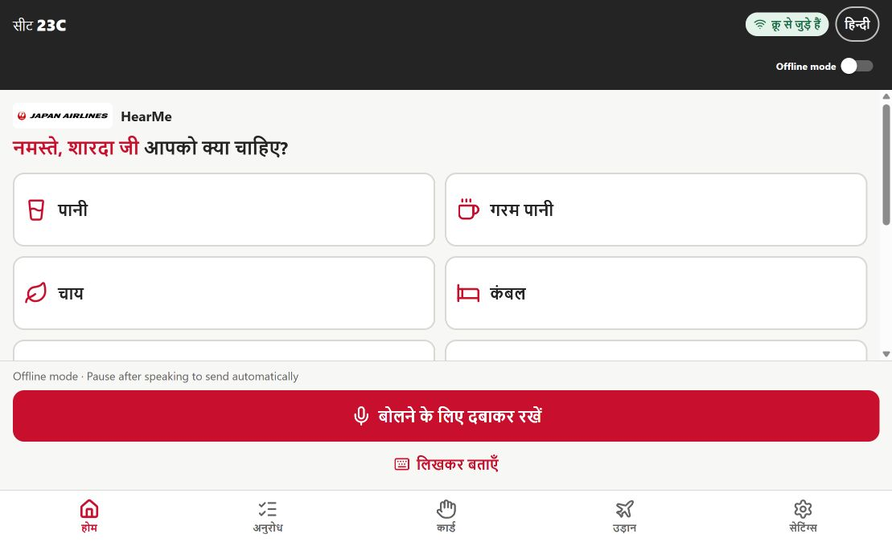
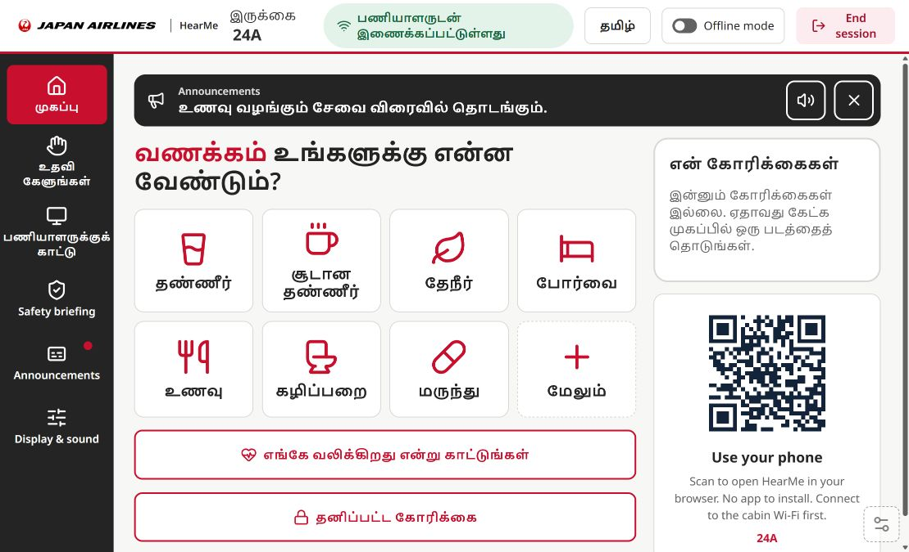
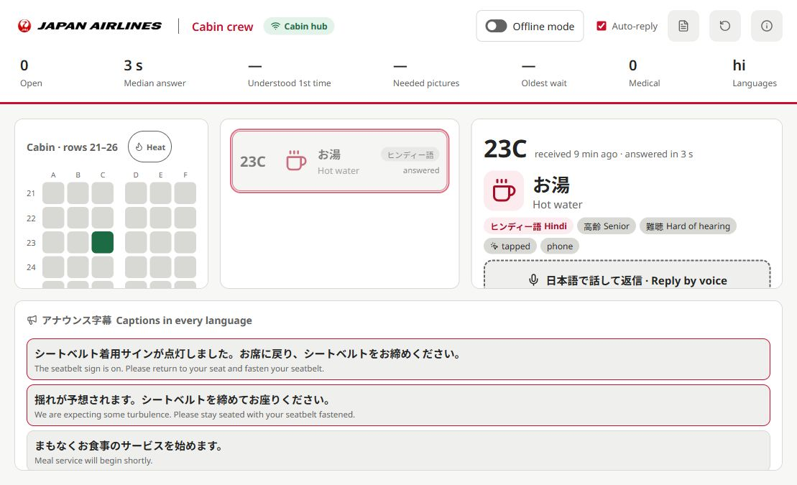

# HearMe

Multilingual communication between passengers and cabin crew, with **Online and Offline modes**, a passenger phone app, a seatback screen and a live crew console.

Passengers can tap a picture, type, or speak in their language. Crew receive a catalogue request in Japanese and English, then reply with translated text and speech. The original passenger and crew workflows are preserved.



[Watch the narrated project demo](docs/demo.mp4) · [English subtitles](docs/demo.srt) · [Walkthrough details](docs/DEMO.md)

## Latest updates

- **Online / Offline switch** on the right of each interface. Pages start offline; cloud processing requires explicit opt-in.
- **Automatic submission after speech:** a pause ends recording and confidently understood requests submit automatically in both modes. Uncertain requests retain clarification pictures; pictures and typing retain manual review.
- **Online voice:** Sarvam Saaras for transcription, Groq for catalogue keyword extraction, Sarvam translation and Bulbul v3 for spoken replies.
- **Online requests outside the catalogue:** Groq identifies uncategorized requests and automatically forwards the passenger's original words and English translation to the crew as **Other request**. This reuses the translation already made for analysis, with no extra translation call. Offline mode keeps the original clarification flow.
- **Other Asian languages stay local**, including Japanese, Thai, Indonesian and Vietnamese.
- **Announcements follow the passenger's language** for both captions and voice, including after a language change. All seven fixed announcements have captions in every selectable language.
- **Recorded announcement audio in all 15 languages**, including Japanese, Thai, Indonesian and Vietnamese. Fixed announcements play bundled MP3s without needing an installed device voice or a live speech-provider request.
- **Crew announcement language selector** for custom spoken or typed announcements. Translations cover all selectable languages, with failures listed before sending.
- **Phone microphone without CA installation** through an optional private HTTPS Cloudflare link. The crew console remains local.
- **A unique QR for each seat**, preserving the private entry link when the seat changes. Live local links follow the current Wi-Fi address; restarting the tunnel supplies a new URL to the live QR displays.

Tara and the wake phrase have been retired. Start voice input using the existing microphone control.

## Actual project screens

Captured from the running application, including the development version of the announcement update. These are actual screenshots using sample booking and request data, not generated mockups.

**Passenger browser app:** original request tiles, microphone, connection status and mode switch.



**Seatback in Tamil:** the meal-service announcement uses the selected language and has a replay control.



<details>
<summary>Crew console and announcement language controls</summary>



</details>

## Get started

Use **Node.js 22 or newer** and npm:

```bash
git clone https://github.com/dibyanshusamal9/HearMe.git
cd HearMe
npm ci
npm run demo
```

The launcher prepares local models, builds the clients, starts the cabin hub and opens the demo. Initial model downloads require internet access; subsequent local inference works offline. Translation models require additional disk space.

- [Live demo](http://localhost:8080/#/stage): phone or seatback, network timeline and crew console.
- [Crew console](http://localhost:8080/#/crew): requests, replies, seat map and announcements.
- [Seatback](http://localhost:8080/?seat=23C#/ife): a passenger screen for the selected seat.
- [Passenger browser app](http://localhost:8080/mobile/?seat=23C).
- [Printable seat cards](http://localhost:8080/seats).

When models and built clients are already present, use `npm run hub`. Keep the hub running while using the phone and crew console.

## Online mode

Copy `.env.example` to `.env` in the repository root and supply your own credentials:

```dotenv
SARVAM_API_KEY=your_sarvam_api_key
GROQ_API_KEY=your_groq_api_key
GROQ_MODEL=openai/gpt-oss-20b
SARVAM_STT_MODEL=saaras:v4
```

Restart the hub after changing `.env`. Keys remain server-side and are excluded from Git. Never put them in browser code or `EXPO_PUBLIC_*` variables.

1. Select **Online mode** and accept the cloud disclosure.
2. Select your language and use the original microphone, picture tiles or typing.
3. Pause after speaking. A confident speech match is submitted to the crew automatically.
4. Crew answer in the existing console. The passenger receives translated text and, when enabled, speech.

Silence does not create a request. Recordings are capped at fifteen seconds; a 1.2-second pause after detected speech ends recording. The demo synchronizes mode with its embedded devices. Standalone devices choose mode and consent independently. Switching offline stops further cloud use and pending cloud playback.

## Languages and models

The Sarvam online path is limited to **ten Indian languages plus English**: Hindi, Bengali, Tamil, Telugu, Marathi, Gujarati, Kannada, Malayalam, Punjabi, Odia and English. Application code `or` maps to Sarvam `od-IN`.

Japanese, Thai, Indonesian and Vietnamese retain local processing, even in Online mode. Translation involving one of those languages uses the local translator. Some secondary interface labels fall back to Hindi or English; recognition, screens and device voices have different coverage.

- **Offline recognition:** Whisper-small, with a faster Whisper-base option.
- **Offline understanding:** multilingual-e5, catalogue matching and the original classifier.
- **Offline translation:** NLLB-200.
- **Online recognition:** Saaras v4.
- **Online keyword extraction:** Groq, defaulting to `openai/gpt-oss-20b`.
- **Online translation:** Sarvam for supported language pairs.
- **Online speech:** Bulbul v3, including Malayalam and Odia.

Identical translations share in-flight work and use a short-lived memory cache. Cloud translations use a bounded work pool. These controls reduce repeated work; latency still depends on the network, provider and hardware. See [performance notes](docs/PERFORMANCE.md).

## Phone microphone without CA installation

Install [Cloudflare's official `cloudflared` client](https://github.com/cloudflare/cloudflared/releases) on your PATH. `CLOUDFLARED_PATH` can point to its executable. The helper also recognizes `.npm-cache/cloudflared/cloudflared.exe` on Windows.

Keep the cabin hub running and open a second terminal:

```bash
npm run phone-link
```

Open the private HTTPS link printed in that terminal in **Chrome on Android or Safari on iPhone**. Allow microphone access when prompted. No app or CA certificate installation is required.

- The link lasts two hours while the helper runs. Running the command again creates a new link.
- Phone recordings, requests and replies travel through Cloudflare over the internet. Offline mode keeps inference local, but this remote phone connection still needs internet access.
- The gateway forwards passenger routes and passenger WebSocket messages. Crew commands, the crew console, lab and administrative routes remain local.
- Each seat gets its own QR with a different seat parameter. The Cloudflare hostname stays the same while its process reconnects after a Wi-Fi change; the new network needs internet access.
- If the tunnel restarts, live QR displays pick up its new link. Printed/exported QR cards must be regenerated; they cannot update themselves.
- Keep the private link private. Access keys, tunnel state and downloaded executables stay in ignored local files.

For cabin-network-only use, join the laptop's Wi-Fi and scan its local QR. Pictures and typing work over HTTP. Microphone access requires trusted HTTPS: use an operator-provided trusted certificate for a deployment, or `/trust` for a local development certificate. An established cabin connection alone does not grant browser microphone access.

## Announcements and voice

The seven fixed announcements cover seatbelt, turbulence, meal service, duty-free, descent, arrival and doctor-call messages in all fifteen selectable languages. These are bundled prototype translations requiring native-speaker and airline review.

For a custom announcement, choose **Announcement language**, speak or type, translate, review the previews, then send to all seats. Failed language translations are listed before sending. Each passenger sees their selected language and hears that caption through Bulbul or an available device voice.

Seatback announcements play when voice is enabled, with replay in the banner and announcement list. Changing the passenger language updates announcement playback. The seven fixed announcements use bundled recordings in all fifteen languages, in either mode. Custom announcements still use Bulbul for supported Online languages or an installed device voice otherwise. Browser autoplay may require a tap first.

Recordings are stored in `apps/mobile/public/announcements/` and served at `/mobile/announcements/`. The Indian-language and English recordings use Bulbul v3; the other four use Microsoft Edge TTS at asset-generation time only. No passenger data is sent to Microsoft at runtime. Regenerating the recordings requires server credentials, Python with `edge-tts`, and `npm run announcements:audio`; normal playback needs none of those generation tools. The bundled manifest records each clip's source and caption hash.

## Project structure

```text
apps/
  hub/          Cabin relay, local models, cloud adapters and HTTP API
  ife/          Seatback, crew console, launcher and demo stage
  mobile/       Expo / React Native passenger app and web export
packages/
  shared/       Catalogue, languages, sessions, matching and speech helpers
scripts/        Launchers and private phone HTTPS access
docs/           Architecture, API, setup, privacy and actual screenshots
```

Provider credentials and calls belong in `apps/hub/src/online/`. Shared product rules belong in `packages/shared/`; presentation stays in the clients.

## Documentation and limitations

- [Modes and usage](docs/MODES.md)
- [Architecture](docs/ARCHITECTURE.md)
- [API](docs/API.md)
- [Privacy](docs/PRIVACY.md)
- [Deployment](docs/DEPLOYMENT.md)
- [Contributing](CONTRIBUTING.md)
- [Original offline README and historical measurements](docs/legacy/README-offline.md)
- [Original demo recording](docs/demo.mp4)

This prototype uses sample booking data and an in-memory relay. Restarting the hub clears active requests. Native Android/iOS microphone behavior remains simulated; real recording is implemented in the browser phone. Language and safety wording need appropriate human review before deployment. Online services incur provider usage; the private phone link is for demonstrations and development.

Tests, lint and typechecks for this update are left to the project owner. No new pass results are claimed here.

## Credits

HearMe began as *HearMe · Idea Submission* by Nidhish Bansal, Dhruv Mittal and Dibyanshu Samal. This repository extends the [original offline prototype](https://github.com/Dhruv-ux-dev/HearMe) with Online / Offline modes, Sarvam and Groq integration, spoken announcements and phone HTTPS access. Existing license notices and upstream assets are retained.
